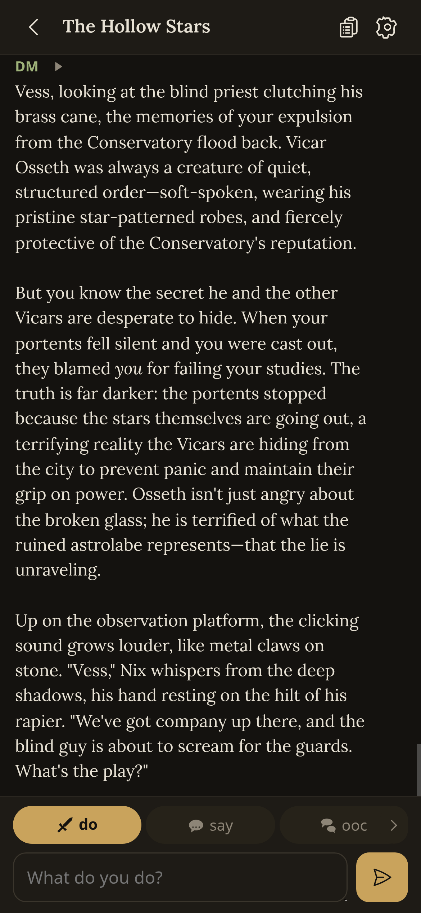
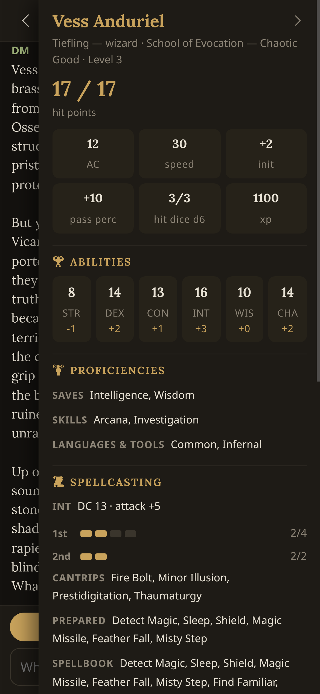

# ogm-light

A small player client for Open Game Master (OGM). Built for playing D&D on
a phone during long solo sessions: the transcript, the composer, the
character sheet, and the DM's narration read aloud. The full OGM app does
everything else.

No build step, no framework, no npm packages. One Node file serves the
static app and proxies `/api/*` to OGM, which keeps every API call
same-origin. OGM's cookie auth and its SSE event stream then work exactly
as the full app sees them, without CORS or token plumbing.

## Running it

On the machine that runs OGM:

```sh
node server.js
```

That serves on 0.0.0.0:3222 and proxies to 127.0.0.1:3005. Open
http://\<host\>:3222 on your phone and log in with your OGM account.

Environment variables, all optional:

| var | default | what it does |
|---|---|---|
| `OGML_PORT` | 3222 | port this server listens on |
| `OGML_HOST` | 0.0.0.0 | bind address |
| `OGML_OGM_URL` | `http://127.0.0.1:3005` | base URL of the OGM service to proxy to, e.g. `http://192.168.1.10:3005` or `https://ogm.internal` |

https URLs work. The L stands for "light": the `OGML_` prefix keeps these
settings away from anything OGM itself defines.

## Screenshots

The table and the sheet, at phone size:





## What's in the box

The transcript shows the latest 30 messages and loads older history on
on demand. Live updates arrive over SSE and survive reconnects through
Last-Event-ID replay. The composer has do/say/ooc modes, plus a hidden
fourth control for whispering privately to the GM. Enter sends and
Shift+Enter makes a newline. The sheet drawer reads the real OGM sheet:
vitals, ability scores, proficiencies, spell slots, features, condition,
equipment, and notes. Narration is a two-way setting — on demand, or
automatic — and prefers the server's rendered takes, falling back to the
browser's own voice. Every hearable reply, whispers included, carries its
own play button.

If the phone sleeps for an hour, the app notices when it wakes and fetches a
fresh page of history instead of replaying a day of SSE events.

## What it won't do

No campaign creation, character editing, maps, dice UI, or admin. That is
the DM's half of the app; this is the player's chair.

## Files

`server.js` serves static files and streams `/api` requests through. It
also rewrites OGM's `odm_session` cookie to `ogml_session` on the way out
and back on the way in, so a stale cookie left in some device's jar by an
old build can never shadow a live session.

`public/` holds `index.html`, `app.js` (vanilla), and `styles.css`, plus
vendored assets: RPG Awesome for the game-flavored marks (swords, scrolls,
speech), Heroicons inlined as SVG for the UI chrome, and the three
narration faces (Lora, Cormorant Garamond, IM Fell English) as woff2 under
`vendor/fonts/`. No CDN calls; the app works with the network cable pulled.

## Design notes

`PRODUCT.md` and `DESIGN.md` sit at the repo root for the impeccable design
tooling. The look is "Traveler's Lamp": a dark room, one brass accent, and a
serif reserved for the DM's voice — Lora by default, with Cormorant Garamond
and IM Fell English selectable in settings.
